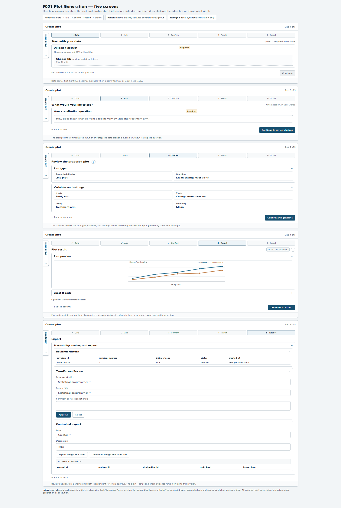

# ADaMViz SubmissionSync

[](https://github.com/Ramdhadage/ADaMViz.SubmissionSync/actions/workflows/check.yaml)
[](https://github.com/Ramdhadage/ADaMViz.SubmissionSync/actions/workflows/pkgdown.yaml)
[](LICENSE)
[](https://lifecycle.r-lib.org/articles/stages.html#experimental)
[](https://github.com/Ramdhadage/ADaMViz.SubmissionSync/commits/main/)
[](https://ramdhadage.github.io/ADaMViz.SubmissionSync/coverage-report/)

> ADaMViz SubmissionSync is an proof of concept for review-ready
clinical visualizations and reproducible R code from permitted ADaM or tabular
data. It is designed for validated clinical submission workflows; it is not
FDA validated or FDA approved.

**Live app:** [Open ADaMViz SubmissionSync](https://ramnath-dhadage.shinyapps.io/ADaMViz-SubmissionSync/)

**Try the app with sample data:** [Download adlb-standard.csv](https://github.com/Ramdhadage/ADaMViz.SubmissionSync/raw/refs/heads/main/inst/extdata/synthetic/adlb-standard.csv)

Save the synthetic sample CSV, then upload it in the app's **Data** step.

**Workflow video:**

<video controls preload="none" width="100%" src="https://github.com/user-attachments/assets/988381fa-8994-44a4-b98f-83c0664b0435"></video>

[Download the full workflow video (MP4, 23.3 MB)](https://github.com/Ramdhadage/ADaMViz.SubmissionSync/releases/download/workflow-video-2026-10-17/Video_Project_Enhanced_Full_Workflow.mp4)

**Prototype preview:**

[](https://htmlpreview.github.io/?https://raw.githubusercontent.com/Ramdhadage/ADaMViz.SubmissionSync/main/docs/ux/F001-plot-generation-prototype.html)

[View in Full Screen](https://htmlpreview.github.io/?https://raw.githubusercontent.com/Ramdhadage/ADaMViz.SubmissionSync/main/docs/ux/F001-plot-generation-prototype.html)

## Development status

ADaMViz SubmissionSync is an experimental proof of concept supporting Data → Ask → Confirm → Result → Export. The current implementation supports CSV/Excel input, longitudinal BDS boxplots, generated R scripts, local execution evidence, human review, and controlled export of Reviewed revisions.
Plotting choices currently come from data and user selections; natural-language interpretation is not connected to the active workflow.

## 🚀 Installation

You can install the development version of ADaMViz.SubmissionSync from
[GitHub](https://github.com/Ramdhadage/ADaMViz.SubmissionSync):

``` r
# Install pak if you haven't already
if (!requireNamespace("pak", quietly = TRUE)) {
  install.packages("pak")
}

# Install ADaMViz.SubmissionSync
pak::pak("Ramdhadage/ADaMViz.SubmissionSync")
```

## Run locally

The package is intended to run from a locked `renv` environment:

```r
renv::restore(prompt = FALSE)
devtools::install()
ADaMViz.SubmissionSync::run_app()
```

After changing application source or CSS, restart R and run
`devtools::install()` from the RStudio Console at the repository root before
launching `app.R`. The launcher uses the installed package.

Provider credentials and secret values must remain outside source files,
prompts, logs, generated scripts, and retained evidence.

Controlled exports are addressed by logical workspace identifiers. A local POC
workspace export writes a detached `plot.png` and `script.R` pair only after the
accepted artifact hashes, acting user, revision token, destination, and final
file hashes are rechecked. The receipt stays inside the internal evidence store.

## 📚 Documentation

For more detailed information and usage examples, please refer to the
[package
documentation](https://ramdhadage.github.io/ADaMViz.SubmissionSync/).

## 🤝 Contributing

Contributions are welcome! Please feel free to submit a Pull Request or
open an Issue on our [GitHub
repository](https://github.com/Ramdhadage/ADaMViz.SubmissionSync).
