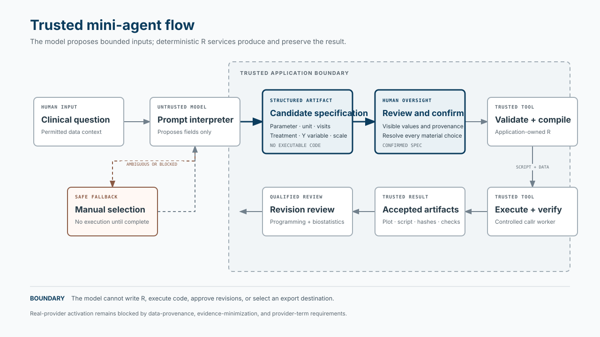

# Implementing Trusted Mini-Agents in SubmissionSync

## Recommendation

Implement one constrained R prompt interpreter, not a general-purpose tool-using agent. Let an LLM propose a plot specification; keep validation, compilation, execution, verification, review, and export in the existing deterministic services. The user must inspect and confirm proposed choices before execution.

This applies the trusted mini-agent pattern while staying within SubmissionSync's R-first architecture and current ggplot scope. The project already has a structured prompt adapter, deterministic mock, candidate specification, compiler boundary, and controlled execution path. The active upload workflow does not yet call the interpreter.

## Contents

- [Implementing Trusted Mini-Agents in SubmissionSync](#implementing-trusted-mini-agents-in-submissionsync)
  - [Recommendation](#recommendation)
  - [Contents](#contents)
  - [Workflow](#workflow)
  - [Evidence by source cluster](#evidence-by-source-cluster)
    - [1. Trusted mini-agent pattern](#1-trusted-mini-agent-pattern)
    - [2. Project fit and result path](#2-project-fit-and-result-path)
    - [3. Current integration gap](#3-current-integration-gap)
    - [4. Privacy, evidence, and review boundaries](#4-privacy-evidence-and-review-boundaries)
  - [Conflicts and limits](#conflicts-and-limits)
  - [Prioritized implementation checklist](#prioritized-implementation-checklist)
  - [Risks](#risks)
  - [Immediate next step](#immediate-next-step)

## Workflow

*Open the diagram for a full-size view. The model proposes fields; application-owned R services produce and preserve the result.*

The model proposes inputs only. It does not produce the plot, run arbitrary R, change review status, or choose an export destination.

Open the primary source map

- Trusted Mini-Agents, pp. 5, 20–23, 45–46: [source PDF](../../../trustedminiagents/_book/Trusted-Mini-Agents.pdf)
- Project direction and boundaries: [strategy](../product/STRATEGY.md), [architecture context](../../CODEX_CONTEXT.md)
- Active implementation and contract: [app server](../../R/app_server.R), [prompt adapter](../../R/prompt_interpreter.R), [canonical assurance plan](../plans/2026-09-06-0014-feat-plot-pattern-assurance-cell-plan.md)
- Privacy and validation limits: [data-flow threat model](../validation/data-flow-threat-model.md), [GxP coding-agent guidance](../references/gxp-coding-agent-guidance.md)

## Evidence by source cluster

### 1. Trusted mini-agent pattern

The supplied guide defines three rules: “Trusted tools directly produce all results,” “Inputs to trusted tools have trusted human oversight,” and “Is the agent solving the right problem?” ([*Trusted Mini-Agents*, Will Landau and Sam Parmar, 2026-08-28, pp. 5, 20–23, 45–46](../../../trustedminiagents/_book/Trusted-Mini-Agents.pdf)). Its clinical-trial simulation example has the model propose assumptions, a human review them, and trusted R functions calculate results.

That maps to SubmissionSync's confirmed plot specification and its distinct `Verified` and human `Reviewed` states ([CONCEPTS.md](../../CONCEPTS.md), [ARCHITECTURE.md](../../ARCHITECTURE.md)). A user confirming intent is not the same as the later statistical-programmer and biostatistician review.

**Action:** Limit the model's output to a reviewable candidate specification and require user confirmation before execution.

### 2. Project fit and result path

The strategy prioritizes submission-oriented trust through statistically appropriate, inspectable, reproducible output and qualified human review. The project context keeps the POC in the ggplot scope and prohibits confidential patient-level data in prompts and external services ([STRATEGY.md](../product/STRATEGY.md), [CODEX_CONTEXT.md](../../CODEX_CONTEXT.md)).

The code already provides reusable boundaries: `interpret_prompt()` normalizes provider output into a bounded candidate and never returns executable code ([R/prompt_interpreter.R](../../R/prompt_interpreter.R)); `confirm_plot_spec()` requires complete fields and provenance ([R/domain_plot_spec.R](../../R/domain_plot_spec.R)); and the deterministic mock and disabled provider placeholder are already present ([R/prompt_interpreter_mock.R](../../R/prompt_interpreter_mock.R), [R/prompt_interpreter_ellmer.R](../../R/prompt_interpreter_ellmer.R)).

The PDF's strong result guarantee is conditional on correct inputs and trusted tools. The project's GxP guidance says tests, mocks, and guardrails support validation but do not establish validation for intended use ([gxp-coding-agent-guidance.md](../references/gxp-coding-agent-guidance.md)). Treat “structurally impossible” as a conditional property of the design, not a validation claim.

**Action:** Keep model output outside the compiler and runner; show users the application-generated artifacts and verification state.

### 3. Current integration gap

The active candidate builder pins a study snapshot and derives choices from its aggregate profile. The canonical assurance plan records that the live upload workflow does not call the prompt interpreter and that the real provider is disabled ([R/app_server.R](../../R/app_server.R), [canonical assurance-cell plan](../plans/2026-09-06-0014-feat-plot-pattern-assurance-cell-plan.md)). A separate helper calling the mock does not establish active workflow integration.

The plan's U7 boundary already calls for allowlisted context, structured candidates, semantic validation, manual fallback, versioned evidence, and a deterministic mock in CI. The smallest first increment is to wire the mock into the active Data → Ask → Confirm flow. It does not require a hosted model or autonomous tool use.

**Action:** Route the active Ask submission through the existing adapter and mock, then display the candidate or clarification in Confirm.

### 4. Privacy, evidence, and review boundaries

The project prohibits confidential patient-level data in prompts and external services. The canonical plan also records that uploads lack permitted-data attestation and revision evidence retains selected rows including `USUBJID`. The real provider stays disabled pending approval of retention, training, region, transport, incident-handling, and disclosure terms ([CODEX_CONTEXT.md](../../CODEX_CONTEXT.md), [canonical assurance-cell plan](../plans/2026-09-06-0014-feat-plot-pattern-assurance-cell-plan.md), [data-flow threat model](../validation/data-flow-threat-model.md)).

Confirmation checks whether the proposed specification matches user intent. Statistical-programmer and biostatistician review checks the resulting revision. Keep both stages. The existing export-policy conflict also remains: Strategy says unreviewed output may be exported only as drafts, while the plan and current code allow some `Verified` exports. Adding an agent does not settle that conflict.

**Action:** Keep real-provider use disabled until the data-provenance and retained-evidence gaps are addressed and provider terms are approved.

## Conflicts and limits

- The guide allows an agent to use untrusted tools during reasoning, provided they cannot produce final results. SubmissionSync's scope does not need general tool use: keep the first implementation to structured interpretation and manual fallback.
- The guide emphasizes easy human review of proposed inputs. SubmissionSync also requires later qualified review of outputs. Input confirmation must not replace the existing review workflow.
- The guide describes result errors as structurally impossible under trusted-tool and correct-input assumptions. Project evidence is local development evidence, not intended-use validation. Keep that qualification in product claims.
- The model may propose a candidate, but only the application's schema and BDS validators can determine whether it is allowed. Ambiguous or invalid output must stop for clarification or manual selection.

## Prioritized implementation checklist

Check items as evidence is completed; source presence alone does not establish acceptance.

- [ ] **Resolve the data boundary.** Establish how the POC attests permitted data and prevents raw subject identifiers from entering model context or durable evidence.
- [ ] **Integrate the mock.** Connect `interpret_prompt()` to active Ask → Confirm. Preserve CSV and Excel upload and the approved plot scope.
- [ ] **Make candidates reviewable.** Show every proposed field, its source or default, and ambiguity. Require user resolution and confirmation before execution.
- [ ] **Preserve one trusted result path.** Keep R generation within the application-owned compiler and controlled execution service. Do not give the model tools for arbitrary R, review, or export.
- [ ] **Align displayed results with accepted evidence.** The architecture notes that the preview is reconstructed in the app instead of showing the accepted worker PNG. Resolve this before claiming the displayed result came directly from the verified execution path.
- [ ] **Capture reproducibility evidence.** Record prompt/specification identity, schema/interpreter/provider versions, input identity, code and environment, checks, artifact hashes, and reviewer decisions while minimizing sensitive content.
- [ ] **Evaluate before provider activation.** Run a versioned synthetic prompt corpus for ambiguity, malformed output, prompt injection, invented fields, timeouts, and fallback. Review provider terms and run separate integration evaluation.
- [ ] **Keep operational claims bounded.** Track authentication, qualified isolation, target-environment validation, and export-policy alignment as separate work.

## Risks

- **Data exposure:** prompts, retries, logs, or retained evidence could contain identifiers or confidential information.
- **Missed errors in confirmation:** users may approve a clear-looking summary without noticing a wrong unit, visit set, or scale.
- **Result-path bypass:** model text or an alternate tool could be mistaken for computed output.
- **Evidence mismatch:** the displayed preview may differ from the artifact that passed execution verification.
- **False assurance:** mock tests and prompt-corpus scores do not establish provider behavior or validation for intended use.
- **Policy drift:** agent integration could make unresolved export and data-boundary decisions appear settled.

## Immediate next step

Wire the deterministic mock interpreter into the active Ask → Confirm path and verify that its confirmed candidate produces the same canonical specification as direct UI selections.
