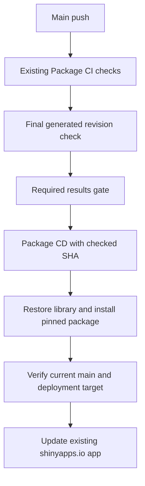

# Package CD

## Goal Capsule

**Objective:** The existing live app updates automatically after successful main push checks.

**Means:** A reusable deployment workflow called by Package CI (KTD1).

**Authority:** The user's confirmed trigger, target, and package pin take precedence. Preserve existing CI checks and app behavior. Stop before committing or publishing; those actions require a separate request.

## Product Contract

### Summary

Replace the manual deployment step with Package CD for the existing shinyapps.io app.

### Problem Frame

Manual installation can select a newer package than the revision that passed CI. Package CI also generates commits on main, so its initial event SHA may differ from the final checked revision.

### Requirements

- R1. Deploy only for a push to main after all existing required checks succeed. Pull requests, manual runs, failed checks, and cancelled checks must not deploy.
- R2. Install pak when absent, then use pak to install the application from its exact checked GitHub commit. Update only the app package entry in the runner's lockfile; do not publish lockfile edits.
- R3. Update app ID 18047061 in account ramnath-dhadage on shinyapps.io using SHINYAPPSIO_TOKEN and SHINYAPPSIO_SECRET from GitHub secrets.
- R4. Preserve the supplied app name, title, appFiles allowlist, lint = FALSE, and forceUpdate = TRUE.
- R5. CD performs deployment preparation and deployment safety checks without repeating package tests, lint, audit, documentation, or package checks.
- R6. Use Chrome DevTools to inspect the live app and state whether that evidence covers the existing deployment or a newly deployed revision.

### Scope Boundaries

Application code, target visibility, credentials, tracked renv.lock, and existing CI requirements remain outside this change. Do not add scheduled deployments, dependency upgrades, generated commits, or a manual CD bypass. GitHub Project capabilities are absent from the available MCP tools; issue tracking remains available.

## Planning Contract

### Key Technical Decisions

- KTD1. Call `.github/workflows/deploy.yaml` from `check.yaml` with native job dependencies on `required-checks` and `generated-check`. This reuses the existing success gate and avoids a separate privileged workflow_run event.
- KTD2. Each existing generator exports only a commit it created. Before checking moving main, generated-check requires the event SHA to be an ancestor and rejects every intervening commit outside those same-run outputs. Export the checked SHA to CD, which rejects a main branch that has moved before upload.
- KTD3. Restore the locked library, install the pinned app without upgrading dependencies, and record that app reference in the runner's lockfile. Preserve strict rsconnect dependency resolution; do not silently enable the historical packrat workaround.
- KTD4. Serialize deployments without cancelling an active upload. Expose shinyapps.io credentials only in the deployment step and disable persisted checkout credentials.
- KTD5. Select one deployment record by account, server, and app name. The correct rsconnect column is appId, not appID; two deployment records exist in this repository.

### High-Level Technical Design

## Implementation Units

### U1. Pass the checked revision to Package CD

**Goal:** Enforce R1 and R5 while preserving the existing check graph.

**Files:** `.github/workflows/check.yaml`, `.github/workflows/deploy.yaml`, `.github/workflows/roxygen.yaml`, `.github/workflows/spelling.yaml`, `.github/workflows/version-bump.yaml`.

**Approach:** Implement KTD1 and KTD2 using a generated-check output and a reusable workflow call. The workflows share a single contract and are implemented together.

**Execution note:** Configuration work uses workflow syntax validation and a condition matrix rather than R package unit tests.

**Test scenarios:** Successful main push permits CD; a PR, dispatch, non-main push, failed required gate, failed generated check, or cancellation skips CD. The checkout and package reference both use the generated-check SHA. Accept same-run generated chains and no-op generators; reject intervening external pushes, external commits beneath generated commits, unrelated force-push history, and stale reruns.

**Verification:** Validate YAML and GitHub expressions, inspect the dependency graph, and exercise the actual gate expression across the event/result matrix.

### U2. Prepare and deploy the existing app

**Dependencies:** U1.

**Goal:** Implement R2-R4 and R6 without duplicating CI.

**Files:** `.github/workflows/deploy.yaml`, `docs/deployment/package-cd.md`.

**Approach:** Follow KTD3-KTD5 and document required secret names, activation, skips, and verification limits.

**Test scenarios:** Missing credentials stop before authentication; exactly one matching deployment record is required; a stale main revision stops before upload; app package SHA equals the checked SHA; bundle allowlist matches the user's list.

**Verification:** Parse embedded R and JavaScript; validate the workflow contract; inspect the live app with Chrome DevTools. A real runner restore, authenticated deployment, and post-deployment browser proof remain separate from local validation.

## Verification Contract

Use actionlint if available, YAML parsing, embedded-code syntax checks, and focused gate/target checks. Do not rerun the full package suite for this workflow-only change. Before any later commit, the repository requires styler::style_pkg(), lintr::lint_package(), and devtools::check(error_on = "warning") from the RStudio Console, followed by explicit commit approval.

## Definition of Done

The workflow changes and deployment notes are reviewable, local checks pass, independent review findings are resolved, and browser observations are reported with their limits. No abandoned experiment files remain. Live CD success can be claimed only after the reviewed workflow is published and an actual main push run deploys successfully.

## Sources

- [teal.gallery deployment reference](https://github.com/insightsengineering/teal.gallery/blob/main/.github/workflows/deploy.yml), inspected 2026-10-15: pak bootstrap, renv restore/cache, secret-backed account setup, and deployApp.
- [rsconnect deployApp](https://rstudio.github.io/rsconnect/reference/deployApp.html): deployment records and strict dependency resolution.
- Existing `.github/workflows/check.yaml`, `app.R`, `renv.lock`, and `rsconnect/shinyapps.io/ramnath-dhadage/ADaMViz-SubmissionSync.dcf`.
